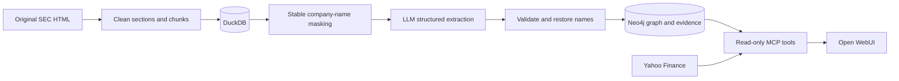

# Picton company graph

A local research application for exploring supplier, customer, competitor, and
product relationships across [ten semiconductor companies](docs/companies.md).
It extracts evidence-backed relationships from SEC filings, stores them in
Neo4j, and exposes read-only MCP tools to an LLM through Open WebUI.

The interface includes filing citations that link to highlighted SEC excerpts
and Yahoo Finance charts for comparing connected companies' stock performance.
An earnings tool retrieves reported EPS, consensus estimates, and beat/miss results.
Document tools search and read the cached SEC filings and earnings-release exhibits.

## How it works



Original source files remain unchanged. Each stage keeps document identity,
dates, and provenance. Repeated graph connections become one edge with multiple
supporting excerpts. Schema checks catch structural problems; they do not prove
that an extracted claim is semantically correct.

## Quick start

Install Docker Desktop (or Docker Engine with Compose). Download and unzip
[`Picton-Interview.zip` from the release](https://github.com/Niyer02/Picton-Interview/releases/tag/v1.0.0),
then run these commands from its root:

```sh
cp .env.example .env
```

Set your own `OPENROUTER_API_KEY` in `.env`, then start everything:

```sh
docker compose up -d --build --wait
```

Open **http://localhost:3080** and chat with **Murph**. No host Python install,
manual graph import, or UI configuration is needed. The first start downloads
the images, restores the bundled graph, and configures the model, tools,
bear avatar, and citation filter. Allow a few minutes and at least 6 GB of
Docker memory. Internet access is needed for image downloads, OpenRouter,
Yahoo Finance, and opening SEC citations.

| Service | Local address |
|---|---|
| Research chat | [Open WebUI](http://localhost:3080) |
| Graph browser | [Neo4j Browser](http://localhost:7474/browser/) |
| MCP endpoint | `http://localhost:3081/mcp` |

The package includes `deploy/seed/neo4j.dump` (27,618 nodes and 65,822
relationships, including evidence) and `data/filings.duckdb` (the document
archive). Keep both when sharing the project. The default Neo4j Browser login
is `neo4j` / `picton-local-demo`; `.env` can override it on first startup.
Existing installations retain their databases, chats and model settings.
Keep their existing `.env` rather than replacing it.

`docker compose down` stops the app and preserves its data. Running the startup
command again reuses it. Do not add `-v` unless you intend to erase saved data.

This setup is a single-user local application with no WebUI login screen.
Do not expose it publicly. Model extraction and chat calls use OpenRouter and
can incur charges; installing dependencies and running offline tests do not.
The distribution contains no API key or personal chat history.

### Using Git instead of the ZIP

Clone the code and download the research data once before following the quick start:

```sh
git clone https://github.com/Niyer02/Picton-Interview.git
cd Picton-Interview
curl -fL https://github.com/Niyer02/Picton-Interview/releases/download/v1.0.0/research-data.tar.gz -o research-data.tar.gz
tar -xzf research-data.tar.gz
```

The archive supplies `data/` and `deploy/seed/neo4j.dump`, which are too large
for ordinary Git files. Extract it only into a fresh clone; existing installations
already have their data. Later code updates use `git pull` followed by
`docker compose up -d --build --wait`. Preserve your `.env` and Docker volumes.

## Project layout

```text
picton_graph/
  config.py, files.py   Shared paths and artifact utilities
  ingestion/           SEC download, HTML parsing, DuckDB, masking
  extraction/          LLM client, validation, corpus runs, name restoration
  evaluation/          GEPA optimization and canonical-agreement scoring
  graph/               Neo4j connection, ontology, validation, importer
  mcp/                 Server, graph queries, evidence, finance, chart asset
  integrations/        Standalone Open WebUI citation filter
tests/                 Unit tests and opt-in Neo4j integration checks
ontology/              OWL source, translated schema, Cypher queries
prompts/               Extraction instructions and examples
benchmarks/gold/       Frozen draft labels and annotation rationale
docs/                  Workflow guides, company basket, experiment reports
deploy/                Dockerfiles, first-start UI setup, and graph snapshot
requirements/          Pinned runtime and research dependency lists
data/                  DuckDB corpus and retained GEPA results; excluded from Git
```

Run Python entrypoints as modules, for example
`python -m picton_graph.ingestion.sec --help` or
`python -m picton_graph.mcp.server --help`. For pipeline development, install
Python 3.11+ and follow the editable-install instructions in [setup](docs/setup.md).
The Docker demo does not need these steps.

## Verification and research limits

```sh
.venv/bin/python -m unittest discover -s tests -t . -v
.venv/bin/ruff check .
.venv/bin/ruff format --check .
```

The normal suite mocks model/provider calls. Neo4j integration checks are
explicitly enabled with `NEO4J_INTEGRATION=1`; see the relevant workflow guide
for their scope. Local gold-source checks use the existing DuckDB corpus when
available. The tests are not a substitute for reading the evidence.

The [evaluation guide](docs/evaluation.md) explains the 20 draft gold examples
and links to the two GEPA experiment reports. Those scores measure agreement
with curated labels, not corpus-wide extraction accuracy. The four holdout
examples were reused, and GEPA did not improve on the revised starting prompt.

Graph edges describe historical disclosures within this basket. Missing edges
do not establish absence, and filing dates are not relationship validity
intervals. Stock comparisons provide observations for research; they do not
establish causality or a statistically significant event-study result.
